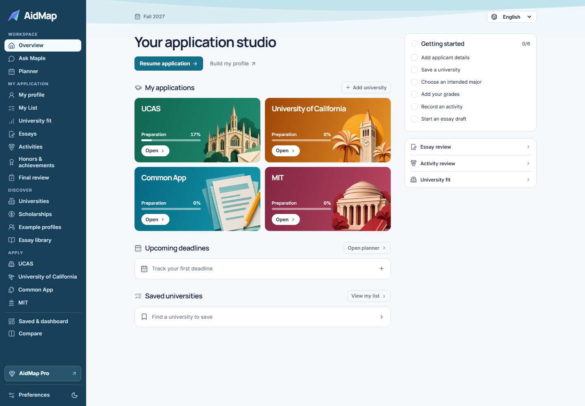
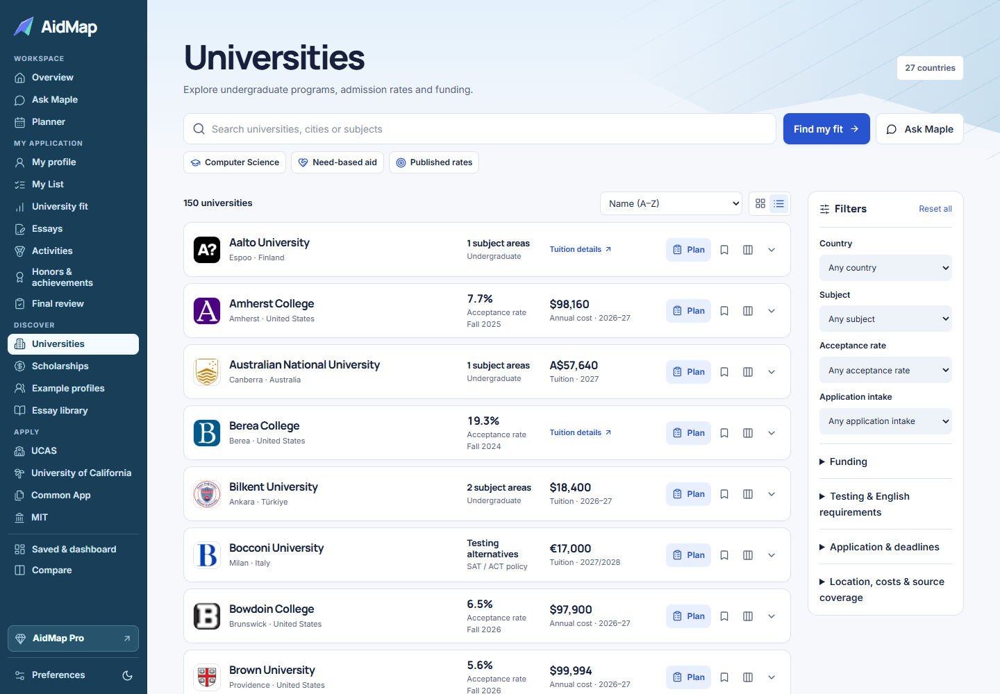
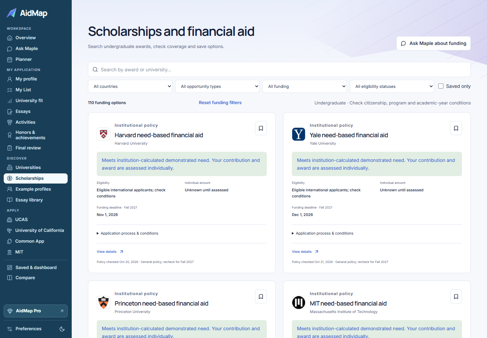
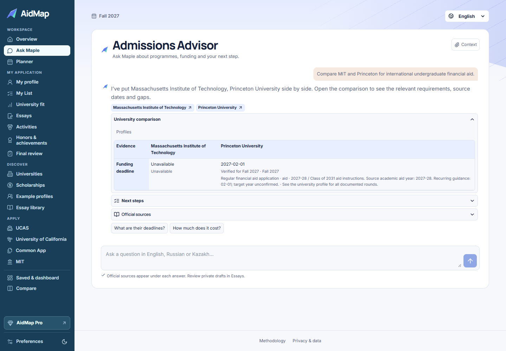
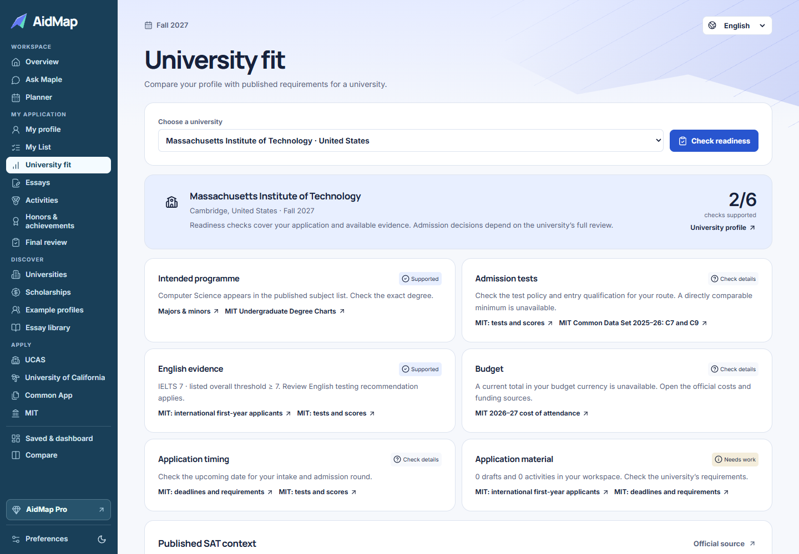
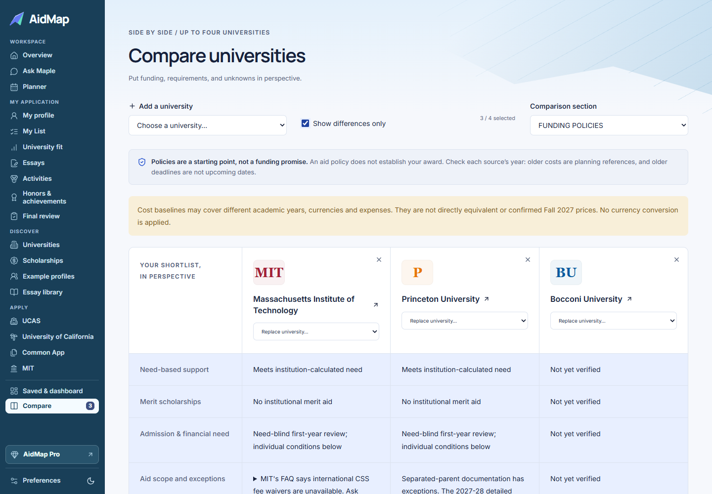
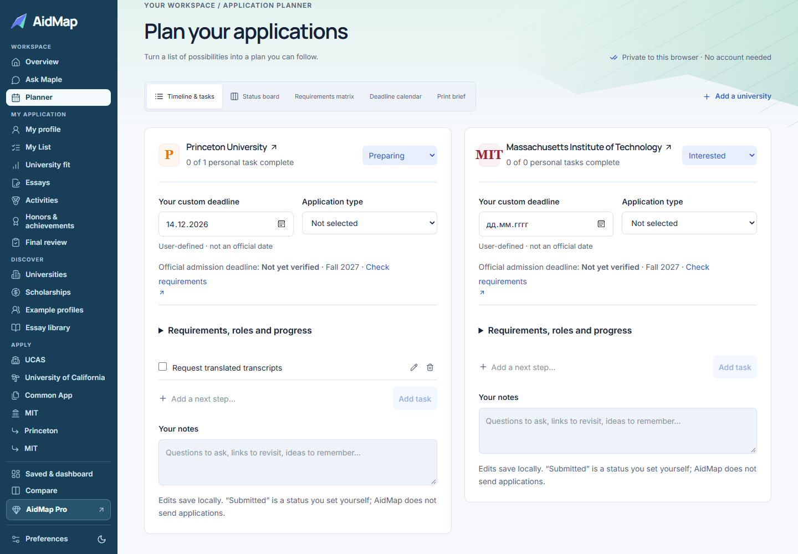
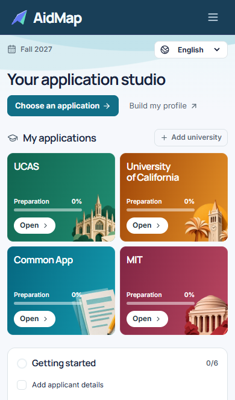

# AidMap

AidMap helps international undergraduate applicants find universities, research funding, and prepare applications. It connects published admissions and aid sources with a browser-local workspace for shortlists, comparisons, essays, tasks, and deadlines.

**150 universities · 27 countries and territories · 110 funding options · 1,325 source-linked evidence records**

## Live Demo

[Open AidMap](https://aidmap-aiaryskaliden.vercel.app/) to explore the public Vercel preview. Start in [University Explorer](https://aidmap-aiaryskaliden.vercel.app/explore), save a university, then open [Deadline Planner](https://aidmap-aiaryskaliden.vercel.app/planner) to organize its application. The core workspace requires no account.



## Features

| Tool                                                                      | What you can do                                                                                                                                                                                                                           |
| ------------------------------------------------------------------------- | ----------------------------------------------------------------------------------------------------------------------------------------------------------------------------------------------------------------------------------------- |
| [Application Studio](https://aidmap-aiaryskaliden.vercel.app/studio)      | Build an applicant profile, prepare essays and activities, record honors, and track preparation for UCAS, the University of California, Common App, and MIT. Import résumé or essay text from PDF, DOCX, TXT, or Markdown in the browser. |
| [University Explorer](https://aidmap-aiaryskaliden.vercel.app/explore)    | Search by university and filter by destination, subject, funding, testing, intake, and published acceptance rate. Open a profile for the scope, cycle, and sources behind its admissions and cost figures.                                |
| [Scholarship Explorer](https://aidmap-aiaryskaliden.vercel.app/funding)   | Search and save institutional aid policies, competitive scholarships, government awards, and fee reductions. Review eligibility, coverage, and separate aid deadlines where documented.                                                   |
| [Ask Maple AI Advisor](https://aidmap-aiaryskaliden.vercel.app/advisor)   | Ask about programmes, costs, funding, or next steps in English, Russian, or Kazakh. The public advisor answers from the AidMap catalogue and links to official sources.                                                                   |
| [University Fit](https://aidmap-aiaryskaliden.vercel.app/studio?view=fit) | Check an applicant profile against published programme, test, budget, and application evidence. Results explain which criteria match and which details need review.                                                                       |
| [Compare](https://aidmap-aiaryskaliden.vercel.app/compare)                | Compare up to four universities side by side across costs, funding, eligibility, and application requirements. Select differences-only to focus on where they diverge.                                                                    |
| [Deadline Planner](https://aidmap-aiaryskaliden.vercel.app/planner)       | Track tasks, notes, dates, and statuses. Use the timeline, status board, requirements matrix, or calendar, and export selected dates as an iCalendar file.                                                                                |
| [Cost Calculator](https://aidmap-aiaryskaliden.vercel.app/calculator)     | Estimate annual cost and the remaining funding gap in one currency. Model hypothetical aid separately from confirmed awards.                                                                                                              |

The screenshot examples use a disposable browser workspace and synthetic applicant inputs.

|                                                                                                                           |                                                                                                                               |
| ------------------------------------------------------------------------------------------------------------------------- | ----------------------------------------------------------------------------------------------------------------------------- |
|  |             |
|              |            |
|            |  |

<details>
<summary>Application Studio on mobile</summary>



</details>

## Run Locally

Use Node.js **24.x** with pnpm **11.25.0**. If pnpm is missing, install the pinned version with `npm install --global pnpm@11.25.0`.

```sh
git clone https://github.com/aiaryskaliden/Aidmap.git
cd Aidmap
pnpm install --frozen-lockfile
pnpm dev --webpack
```

Open <http://127.0.0.1:3000>. The catalogue, workspace, and public Maple mode run with no environment variables. Optional services are described in the [Advisor guide](docs/AI_ADVISOR.md) and [.env.example](.env.example).

To run the production build locally, stop the development server and run `pnpm build` followed by `pnpm start`.

## Architecture

| Layer                                                                                           | Responsibility                                                                                                                                         |
| ----------------------------------------------------------------------------------------------- | ------------------------------------------------------------------------------------------------------------------------------------------------------ |
| [`app/`](app) and [`components/`](components)                                                   | Next.js App Router pages and responsive workspaces. Discovery filters use shareable URL parameters.                                                    |
| [`data/`](data), [`types/`](types), and [`lib/validation/`](lib/validation)                     | Checked-in research, typed domain records, and schema, cycle, and source-reference validation.                                                         |
| [`lib/funding/`](lib/funding), [`lib/matching/`](lib/matching), and [`lib/studio/`](lib/studio) | Cost calculations, explainable fit checks, application checklists, and draft reviews.                                                                  |
| [`lib/storage/`](lib/storage)                                                                   | Versioned browser storage for the applicant workspace, with JSON backup and restore plus CSV shortlist export.                                         |
| [`app/api/advisor/`](app/api/advisor) and [`lib/advisor/`](lib/advisor)                         | Public catalogue-backed responses. An optional Groq coaching mode requires separate configuration and explicit consent for authorized synthetic demos. |

The optional Pro workspace adds a university-specific checklist, funding and deadline views, and essay drafts. The repository includes Stripe checkout and customer portal integration for configured deployments, plus a no-charge local preview. See [.env.example](.env.example).

## Technology Stack

- **Application** — Next.js 16, React 19, TypeScript, Tailwind CSS 4, and Zod
- **Verification** — ESLint, Vitest, and Playwright
- **Hosting** — Vercel Preview

See [package.json](package.json) and the [lockfile](pnpm-lock.yaml) for dependencies.

## Data Sources

The catalogue draws on official university admissions, programme, tuition, and financial aid pages, institutional Common Data Sets, and official government scholarship pages where applicable. The [methodology](docs/DATA_METHODOLOGY.md) explains attribution and evidence labels. The [150-university research record](docs/research/CATALOGUE_150.md) lists the latest additions and their programme sources.

- University records carry source URLs, review dates, and intake or cohort labels where available. Historical SAT distributions and admission rates describe specific cohorts. Current entry requirements are recorded separately.
- The 110 funding entries comprise 45 institutional policies, 56 competitive scholarships, 5 government scholarships, and 4 fee reductions. Full tuition and full cost of attendance are distinct. Individual awards and affordability depend on the institution’s assessment and the applicant’s circumstances.
- The evidence total counts field-level records in the [normalized catalogue](data/universities.ts), including entries that refer to the same source URL. The data validator reports that total. The live [university catalogue](https://aidmap-aiaryskaliden.vercel.app/explore) and [funding catalogue](https://aidmap-aiaryskaliden.vercel.app/funding) display their respective record counts.

## Testing

```sh
pnpm lint
pnpm typecheck
pnpm validate:data
pnpm test
pnpm exec playwright install chromium
pnpm test:e2e
```

Vitest covers catalogue rules, funding arithmetic, fit checks, advisor logic, and workspace state. Playwright exercises student journeys at desktop, tablet, and mobile widths in Chromium. It starts a local server when port 3000 is free. With Edge already installed on Windows, set `$env:PLAYWRIGHT_CHANNEL = 'msedge'` before running `pnpm test:e2e` to use Edge.

## Limitations

- Coverage varies by institution and intake. Some Fall 2027 costs, deadlines, eligibility rules, and requirements remain incomplete. Check the linked official sources before making decisions.
- Fit checks and essay feedback are preparation aids. AidMap provides no admissions probability, award decision, or guarantee of affordability.
- AidMap does not submit applications, send reminders, or sync across devices. Clearing site data removes the local workspace. Use JSON export to keep a backup.
- The public Maple mode uses catalogue logic. External model coaching requires a configured, authorized demo.

## Roadmap

- Verify more Fall 2027 admissions and aid deadlines, applicant-specific requirements, and dated cost breakdowns.
- Improve the editorial workflow for refreshing sources and broadening coverage of affordable programmes.
- Expand real-device and assistive-technology testing, and evaluate opt-in deadline reminders.

See [CONTRIBUTING.md](CONTRIBUTING.md) for contribution instructions.
