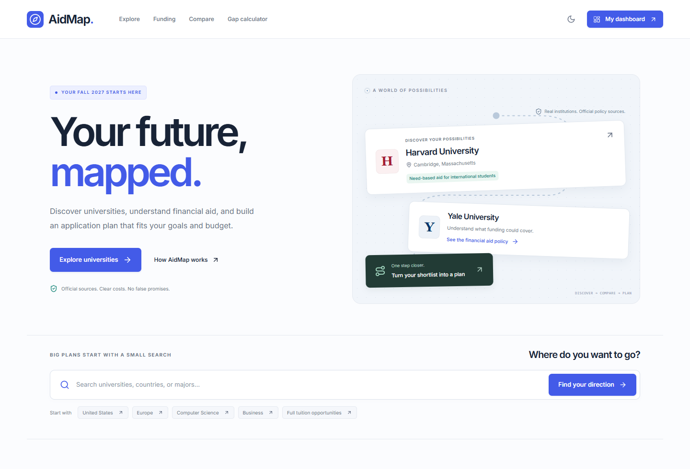

# AidMap

**Find universities. Understand funding. Plan your future.**

AidMap is a local-first university research and application-planning MVP for international undergraduate applicants. It connects a small, source-backed US university directory with funding uncertainty, a whole-cost calculator, and a private applicant workspace. Initial planning cycle: **Fall 2027**.

There are no accounts, paid APIs, applicant uploads, analytics, or required environment variables. AidMap does not submit applications or predict admissions decisions.

## Run locally

Use Node.js 24 and pnpm 11.25.0.

```sh
corepack enable
corepack prepare pnpm@11.25.0 --activate
pnpm install --frozen-lockfile
pnpm dev
```

Open **http://127.0.0.1:3000**. If Corepack is unavailable, install pnpm using its official installation instructions. On the original Codex workstation, pnpm is already available.

```sh
pnpm lint
pnpm typecheck
pnpm validate:data
pnpm test
pnpm exec playwright install chromium
pnpm test:e2e
pnpm build
pnpm start
```

For an installed Microsoft Edge browser on Windows, no browser download is needed:

```powershell
$env:PLAYWRIGHT_CHANNEL = 'msedge'
pnpm test:e2e
```

Playwright starts the development server if needed, or reuses port 3000 locally. It covers desktop and a mobile viewport in Chromium; this is not a Safari compatibility claim. Some managed Windows sandboxes block loopback and child-process IPC: run preview/browser tests in a terminal permitted to use loopback. Production builds use Next.js's supported Webpack bundler because a Turbopack CSS worker failed on the development host. No application code depends on Windows paths.

## What is implemented

| Route                  | Working behavior                                                                                                                      |
| ---------------------- | ------------------------------------------------------------------------------------------------------------------------------------- |
| `/`                    | Original AidMap identity, functional search/chips, official-data featured universities, funding explanations, planner introduction    |
| `/explore`             | Search, combined URL-backed filters, sorting, grid/list views, save and comparison actions, honest empty states                       |
| `/universities/[slug]` | Eight typed profiles, academic fields, admissions/funding policies, field-level evidence and source notes, research checklists        |
| `/compare`             | Up to four persistent selections, replacement/removal, optional differences-only view, horizontally scrollable table                  |
| `/funding`             | Searchable/filterable institutional aid policies, save actions, eligibility/source links, separate aid deadlines                      |
| `/calculator`          | Seven cost categories, unknown handling, confirmed-award base case, separate hypothetical result, currency isolation, saved scenarios |
| `/dashboard`           | Real saved universities, task counts, custom dates, scenarios, saved funding policies and explainable subject matches                 |
| `/planner`             | Status updates, personal dates, notes, task creation/edit/delete/complete, deadline-sorted cards and a status board                   |
| `/profile`             | Optional validated preferences, explicit synthetic demo, JSON export/import preview, CSV shortlist export, local reset                |
| `/about`               | Dataset, funding, matching and privacy methodology                                                                                    |

Light/dark themes, responsive navigation, reduced-motion support, keyboard-accessible native controls, safe external links, loading/error/empty states, custom favicon and route metadata are included. Shared button composition follows the shadcn/ui approach with Radix Slot and class-variance-authority; no full component library is required.

## Data and evidence

The initial dataset contains **8 institutions and 81 field-level evidence entries**, researched from official pages on **October 18, 2026**:

Harvard, Yale, Princeton, MIT, Amherst, Dartmouth, Bowdoin and Brown.

- Raw findings: `research-universities.json`.
- Normalized typed records and policy opportunities: `data/universities.ts`.
- Zod schemas and nullable facts: `types/domain.ts`.
- Consistency checks: `lib/validation/universities.ts` and `scripts/validate-data.ts`.
- Research policy and source index: [docs/DATA_METHODOLOGY.md](docs/DATA_METHODOLOGY.md).

**Source-checked is not the same as cycle-confirmed.** General policies retain a null/general cycle. Aid deadlines are distinct from admission deadlines. The UI links claims to exact source entries, including notes and check dates. Unknowns are stored as null, never zero. No live scraper updates the data automatically; maintenance requires editorial review.

The eight institutions are highly selective and do not constitute a balanced application list or a representative affordability database. European records and competitive scholarships have deliberately not been fabricated to fill filters.

## Financial logic

Pure TypeScript functions in `lib/funding/calculate.ts` implement:

1. Sum every cost category only when all are known. Otherwise return a known subtotal and unknown total/gap.
2. Subtract only an explicitly self-reported confirmed award in the same currency, with a zero floor.
3. Compare remaining cost with the applicant's annual contribution.
4. Calculate hypothetical total-award scenarios separately; they never modify the base case.

Amounts use integer minor units for arithmetic, with two decimal places, to avoid floating-point rounding gaps. Inputs reject negative, nonfinite, or oversized amounts.

A full tuition award does not eliminate housing, meals, insurance and other costs. A full-need policy does not establish an applicant's personal award. Student employment and loans are not counted as confirmed grants. UI-entered costs are assumptions, even when a user has consulted an official page. AidMap does not validate award documents.

USD, EUR, GBP and KZT are supported as separate scenario currencies. Switching currency clears amounts. There are no exchange-rate conversions or implied parity between currencies.

## Local data and privacy

`aidmap:v1` in browser local storage contains a versioned Zod-validated workspace. The storage layer is independent of UI components; a future account/sync adapter can replace it.

- No profile, budget, notes or financial amounts appear in shareable search URLs.
- Corrupted or unsupported stored data is retained and blocks overwriting until the user exports the original and resets/imports.
- Storage-access/quota failures show an explicit warning; in-memory changes may last only for the current session.
- JSON imports are size-limited and validated; the user reviews counts before replacing the workspace.
- CSV cells escape quotes/newlines and guard formula prefixes.
- Clearing browser data deletes the workspace. Export backups to keep it. A shared browser profile is not an encrypted vault.

## Architecture

```text
app/                    App Router routes, metadata and global styles
components/
  layout/               Header, footer and workspace navigation
  ui/                   Buttons, evidence labels, states and notices
  universities/         Explorer, cards, profiles and comparison
  funding/              Calculator and funding explorer
  workspace/            Profile, dashboard and planner
data/                   Validated university/policy records
lib/
  funding/              Pure financial calculations
  matching/             Explainable deterministic research rules
  storage/              Pure state transitions and export handling
  validation/           Source/data consistency validation
types/                  TypeScript and Zod domain contracts
tests/                  Vitest rules and Playwright student journeys
docs/                   Research, design and roadmap documentation
```

Stack: Next.js App Router, React, strict TypeScript, Tailwind CSS 4, local Inter font, shadcn-style/Radix button primitives, Lucide, Zod, Recharts, Vitest and Playwright. Dependency versions are locked by `pnpm-lock.yaml`. Recharts is used only for actual user-entered cost composition.

## Tests and screenshots

Unit tests cover funding arithmetic, full tuition vs total costs, unknowns, currencies, combined filters, international eligibility, transparent matching, local round-trips, comparison limits, task updates, corrupt data and evidence validation failures. Playwright covers the complete research-to-planning journey, backups, theme persistence, corruption handling and page overflow at desktop/mobile widths.

Playwright produces screenshots in `test-results/` and a local HTML report in `playwright-report/` (both ignored by Git). See [docs/VALIDATION.md](docs/VALIDATION.md) for the actual validation status and any limitations. Do not infer successful verification merely from the presence of a test file.



View the [filtered explorer](docs/screenshots/explore-desktop.png), [university profile](docs/screenshots/university-desktop.png), [financial calculator](docs/screenshots/calculator-desktop.png), [mobile homepage](docs/screenshots/home-mobile-first-screen.png), and [dark theme](docs/screenshots/preferences-dark.png).

To recreate the curated screenshots against a running local server:

```sh
node scripts/capture-preview.mjs
```

The script uses an isolated browser context and synthetic calculator inputs. Set `PLAYWRIGHT_CHANNEL=msedge` to use installed Edge, or install Playwright Chromium first. Set `AIDMAP_PREVIEW_URL` to target a different local port.

## Vercel deployment preparation

See [docs/VERCEL_PREVIEW.md](docs/VERCEL_PREVIEW.md) for the protected Preview workflow and deployment privacy review. `.vercelignore` restricts CLI uploads to application and build inputs.

A protected **Preview** is available at [aidmap-aiaryskaliden.vercel.app](https://aidmap-aiaryskaliden.vercel.app). It requires Vercel access, with Vercel Authentication enabled for all deployment URLs. The temporary Production placeholder separately authorized for project initialization has been deleted; only the Preview remains, with this owner-requested alias. No paid plan or public sharing was enabled.

For subsequent Preview deployments:

1. Use Node.js 24, matching `engines.node`, and Vercel CLI.
2. Sign in yourself with `vercel login` and link to the existing AidMap project.
3. Confirm Vercel Authentication still protects Preview deployments.
4. Run `vercel deploy --dry --json` and review the upload manifest.
5. Run `vercel deploy --target preview`. Keep the commands in `vercel.json`: they enforce Preview before installation and build.
6. Confirm Ready status, Preview classification and unauthenticated login redirects before sharing the protected URL.

No application environment variables, external services or applicant-data backend are required. Do not delete the last remaining deployment and blindly retry: a new/empty project's first deployment can be assigned to Production even with an explicit Preview target. See the deployment record for the initialization workaround and authorization history. Publishing publicly or deploying the application to Production requires separate authorization.

The core product has no runtime API/backend dependency after pages and client assets load. The default distribution still needs a Next.js host to serve routes; it is not a fully offline PWA.

## Current limits and next steps

- Fall 2027 tuition/cost breakdowns, admission deadlines, application fees/waivers and application platforms remain unverified. Corresponding filters correctly exclude unknown data rather than invent matches.
- Aid dates and forms have differing cycle coverage. Princeton's aid deadline table needs confirmation; Bowdoin and Yale have country/process-specific caveats. See the source notes.
- No competitive merit-award or European records yet. Full-need policies are not labeled as full tuition or full-ride awards.
- Matching currently uses documented interests, destinations and funding policies. Citizenship restrictions, test thresholds and deadline compatibility require individual review; there are no admission probabilities.
- The planner sorts cards by custom date and offers a status board. It does not send reminders, submit applications, or sync with Common App.
- English-only UI. No partial Russian switch is exposed. Future localization should move complete route content into typed locale dictionaries before exposing another language.
- No cloud sync, multi-device identity or conflict-resolved concurrent editing; latest browser storage writes win.

See [docs/ROADMAP.md](docs/ROADMAP.md) and [CONTRIBUTING.md](CONTRIBUTING.md). No project license has been selected; dependency licenses remain their own.

> AidMap is an independent university research and planning tool. Admissions and financial aid decisions are made by the institutions. Always verify requirements with official sources.
